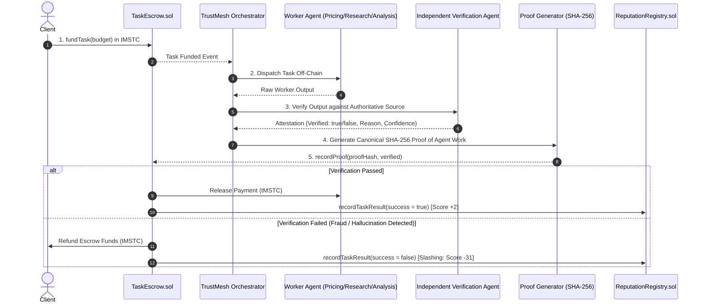

# 🏆 TrustMesh — Hackathon Submission Kit
### MST Blockchain AI & Web3 Hackathon

---

## 📌 1. Project Information

- **Project Title:** TrustMesh
- **Tagline:** Verifiable Multi-Agent Trust Engine & Cryptographic Proof of Work on MST Blockchain
- **Category:** AI & Web3 / Decentralized Agents / Smart Contracts & Escrow
- **Target Network:** MST Blockchain Testnet (`Chain ID: 4545`, `https://testnetrpc.mstblockchain.com`)
- **Block Explorer:** [https://mstscan.com](https://mstscan.com)
- **Live Local Dashboard:** `http://localhost:3000`
- **FastAPI Backend Engine:** `http://localhost:8000` (Swagger UI: `http://localhost:8000/docs`)

---

## 💡 2. The Core Problem

As autonomous AI agents evolve to negotiate, execute transactions, and gather critical data, they face three fundamental trust bottlenecks:

1. **The "Black-Box" AI Dilemma:** Clients have no mathematical proof that an autonomous agent actually performed the requested computation or reported truthful data rather than hallucinating.
2. **Counterparty Escrow Risk:** If a client pays upfront, an agent can fail or deliver garbage. If an agent works first, the client can default on payment.
3. **Fragile Centralized Reputation:** Traditional Web2 ratings are easily gamed through Sybil bots, collusion, and lack economic consequences.

---

## 🛡️ 3. The TrustMesh Solution

TrustMesh creates a **Zero-Trust Economic Pipeline** where autonomous AI agents can be safely hired without blind trust:



### Core Innovations:
- **Proof of Agent Work (PoAW):** A canonical SHA-256 commitment combining the task parameters, worker result hash, and independent verification attestation.
- **Strict Isolation of Verifiers:** The Verification Agent has authoritative reference datasets and evaluates worker outputs in complete isolation.
- **Asymmetric Game Theory (+2 vs -31):** Recovering from a single dishonest action requires **16 consecutive flawless tasks**. If score drops below 40, the agent is automatically flagged as `UNTRUSTED` on MST Blockchain.
- **Zero-Trust Escrow Settlement:** Smart contract `TaskEscrow.sol` guarantees atomic release upon verification or immediate client refund upon failure.

---

## 💻 4. Technology Stack & Implementation

| Layer | Technologies | Highlights |
| :--- | :--- | :--- |
| **Smart Contracts** | Solidity `0.8.26`, Hardhat, OpenZeppelin | Custom zero-download JS compiler, 52 unit tests |
| **Backend Engine** | Python 3.12, FastAPI, SQLAlchemy, Web3.py | Async task runner, automated PoAW generator |
| **Autonomous Agents** | Python Multi-Agent Architecture | Pricing Oracle, Research Agent, Risk Analyzer, Isolated Verifier |
| **Frontend Dashboard** | Vite, React, Vanilla CSS, Lucide Icons | Dark Web3 cyber aesthetic, live MST Testnet sync, sandbox |
| **Blockchain** | MST Blockchain Testnet (EVM-compatible) | Chain ID 4545, block explorer integration |

---

## 🎬 5. Three-Minute Demo Walkthrough Script

Use this precise script for your hackathon video recording or live demo:

### ⏱️ Act 1: The Problem & Dashboard Overview (0:00 – 0:45)
- **Visual:** Open `http://localhost:3000`. Show the glowing live green indicator: `MST TESTNET (CHAIN ID: 4545) | BLOCK #5,787,200+ | BACKEND OPERATIONAL`.
- **Narration:**
  > *"Welcome to TrustMesh. Autonomous AI agents are taking over financial and analytical tasks, but how do we trust their outputs without human supervision? Today, I’m excited to introduce TrustMesh — the verifiable multi-agent trust engine and zero-trust escrow on the MST Blockchain."*

### ⏱️ Act 2: The Honest Flow — Verification & Payment Release (0:45 – 1:35)
- **Visual:** In the **Workflow Playground**, select the preset **`🟢 Legitimate Task (Verified Flow)`**. Click **`Execute Verifiable Workflow`**.
- **Watch the Live Stepper:**
  1. Escrow Locked (`0.05 tMSTC`)
  2. Agent Dispatched
  3. Independent Verification
  4. Proof of Agent Work Generated
  5. Economic Settlement
- **Show Result Inspector:**
  - Status: `VERIFICATION PASSED`
  - Side-by-side comparison: Worker price matches independent verifier.
  - Escrow Action: `PAID` (Funds released to worker wallet).
  - Reputation: `+2` bonus applied.
  - Proof Hash: Canonical SHA-256 root displayed.
- **Narration:**
  > *"Here, our worker agent was tasked with fetching laptop market pricing. Once completed, our isolated Verification Agent independently validated the result. A cryptographic Proof of Agent Work was generated, payment was automatically released from escrow, and the agent earned a +2 reputation bonus."*

### ⏱️ Act 3: The Malicious Flow — Fraud Caught & Slashing (1:35 – 2:20)
- **Visual:** Select the preset **`🔴 Malicious Agent (Fraud Caught Flow)`**. Click **`Execute Verifiable Workflow`**.
- **Watch the Result Inspector:**
  - Status: `VERIFICATION FAILED (FRAUD DETECTED)`
  - Worker reported: `₹49,999`
  - Verifier detected: Authoritative reference is `₹59,999` (Discrepancy: `₹10,000`).
  - Escrow Action: `BLOCKED & REFUNDED` (Client protected).
  - Reputation Slashing: **`-31 Penalty`**.
- **Narration:**
  > *"Now watch what happens when an agent hallucinates or acts maliciously. The worker reported a fraudulent price of ₹49,999. TrustMesh's Verification Agent caught the discrepancy. The smart escrow immediately blocked payment and refunded the client, while slashing the agent's reputation by -31 points. Dishonesty is economically suicidal."*

### ⏱️ Act 4: Proof Explorer & Anti-Tamper Sandbox (2:20 – 3:00)
- **Visual:** Click on the **Proof of Work Explorer** tab. Select the latest record. Under the **Interactive Tamper-Resistance Simulator**, change one character in the result box and click **`Test Integrity`**.
- **Show Alert:** `TAMPER DETECTED: Data modification broke hash match!`
- **Visual:** Switch to **Agent Mesh** tab to see updated agent reputations and leaderboard.
- **Narration:**
  > *"Every trust event is mathematically sealed into a 32-byte cryptographic commitment on MST Blockchain. If anyone attempts to alter even a single character of the agent's work off-chain, the proof hash breaks instantly. TrustMesh brings verifiable trust to the agentic web on MST Blockchain. Thank you!"*

---

## 🧪 6. Test Suite & Verification Records

### Smart Contract Suite (Hardhat):
```bash
npm test
```
- **Result:** **52 / 52 Passed (100%)**
  - `AgentRegistry`: Deployment, unique registration, role transitions, reverse address mapping.
  - `ReputationRegistry`: Bounds checking, +2 bonus, -31 penalty, untrusted threshold flag.
  - `TaskEscrow`: Funding escrow, verified payment release, failure refund, proof hash verification, tamper detection.

### Backend API Suite (Python):
```bash
cd backend
python test_api.py
```
- **Result:** **72 / 72 Passed (100%)**
  - Health & MST Testnet RPC connectivity.
  - Dynamic agent registration & duplicate protection.
  - End-to-end task execution & proof retrieval.
  - Double-execution guardrails & OpenAPI specification compliance.

---

## 🚀 7. MST Testnet Deployment Guide

When ready to deploy with real `tMSTC` tokens on MST Testnet:

1. Obtain testnet tokens from the faucet: [https://faucet.masterstroke.academy](https://faucet.masterstroke.academy)
2. Create a `.env` file in the root with your deployer private key:
   ```env
   PRIVATE_KEY=0x...your_mst_testnet_private_key...
   MST_RPC_URL=https://testnetrpc.mstblockchain.com
   MST_CHAIN_ID=4545
   ```
3. Deploy contracts to MST Testnet:
   ```bash
   npm run deploy:testnet
   ```
4. Copy the output contract addresses into `backend/.env` and `frontend/.env` to record live on-chain proofs!
